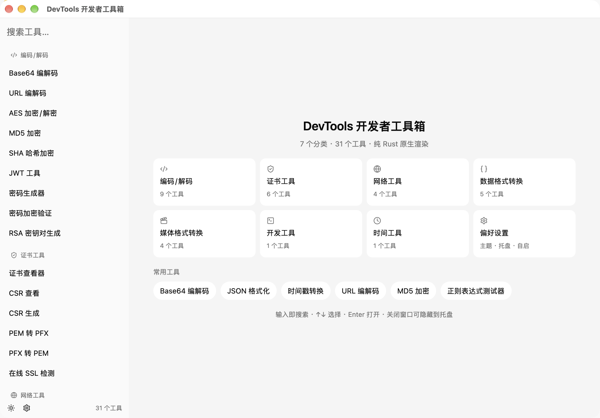
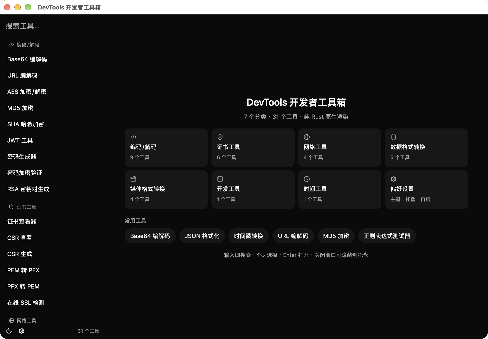
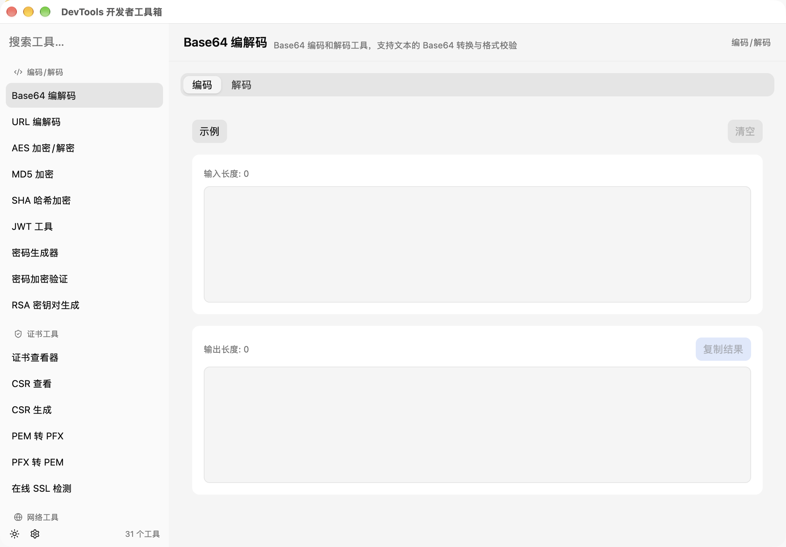
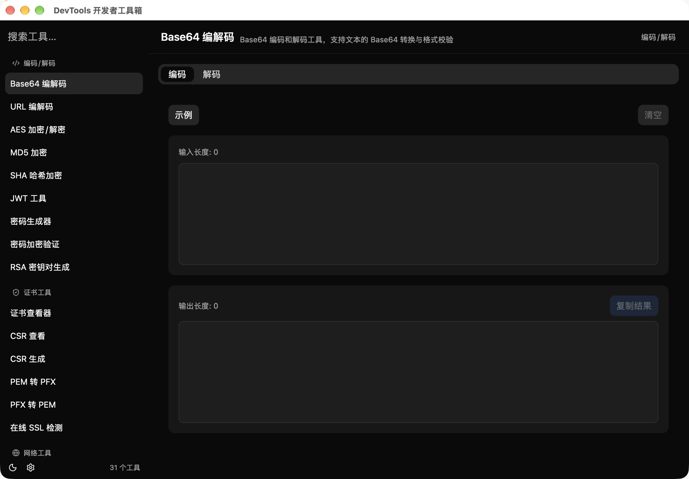

# DevTools 开发者工具箱

[](https://github.com/daixijun/devtools/actions/workflows/ci.yml)

A cross-platform developer toolbox built with **pure Rust + GPUI** (native GPU-rendered UI) — 31 developer tools in one lightweight native app. No webviews, no Electron: one binary, instant startup, and a native grouped-view interface in light & dark themes. Available for **macOS (Apple Silicon), Windows, and Linux**, with **Simplified Chinese / English** UI.

> 📖 中文说明：[README_ZH.md](README_ZH.md) · 详细工具使用指南（中文）：[docs/tools.md](docs/tools.md)

| Light | Dark |
| --- | --- |
|  |  |
|  |  |

## ✨ Highlights

- **31 tools / 7 categories** — encoding, crypto, certificates, network, data-format, media, and more (see below)
- **Pure Rust, native rendering** — gpui (`gpui-pre` + `gpui-component`); no webview memory overhead
- **Native look** — grouped-view cards, segmented tabs, system switches, macOS system-blue accent; light / dark / follow-system themes
- **Cross-platform** — macOS (Metal), Windows (Win32 + DirectWrite), Linux (Wayland / X11); tray on macOS & Windows, single instance everywhere
- **Bilingual UI** — Simplified Chinese / English, switchable in Settings and effective immediately (system locale auto-detected by default)
- **Single main window** — category sidebar with instant type-to-search, tool content area, tray menu, app menu
- **Single instance** — launching again activates the existing window instead of opening a second app
- **Close to tray** — closing the window hides it to the tray (macOS/Windows; Linux minimizes); reopen or relaunch brings it back instantly
- **Update check** — the app menu's "Check for Updates" queries GitHub Releases and links to the latest release
- **Reliable crypto** — byte-compatible with the historical JS implementation, verified against golden vectors (RFC 1321/6234/7914, noble AES vectors)

## 🧰 Tools

| Category | Tools |
| --- | --- |
| **Encoding / Decoding** (9) | Base64 encode/decode · URL encode/decode · AES encrypt/decrypt (5 modes × 6 paddings) · MD5 · SHA / SHA-3 · JWT generate/decode · Password generator · Password hasher (bcrypt/PBKDF2/SHA/MD5) · RSA key pair (unified PKCS#8/PKCS#1/OpenSSH format) |
| **Certificates** (6) | Certificate viewer · CSR viewer · CSR generator · PEM → PFX · PFX → PEM · Online SSL checker |
| **Network** (4) | Subnet calculator · IP info · DNS resolver · Whois lookup |
| **Data Format** (5) | JSON formatter · Format converter (JSON/YAML/TOML) · JSON → Go struct · SQL → Go struct · SQL → Go Ent ORM |
| **Media** (4) | Image converter · Image previewer · Image compressor · Video converter (system FFmpeg) |
| **Developer** (1) | Regex tester |
| **Time** (1) | Timestamp converter |

Each tool's usage is documented (in Chinese) in [docs/tools.md](docs/tools.md).

## 🚀 Getting Started

**Prerequisites**: Rust (2021 edition). macOS 12+ additionally needs the Apple Metal Toolchain (`xcodebuild -downloadComponent MetalToolchain`, required by gpui's Metal shaders) and libheif (`brew install libheif`). Linux needs the GPUI stack: `libgtk-3-dev libxkbcommon-dev libwayland-dev libvulkan-dev libfontconfig1-dev` (Debian/Ubuntu). The video converter shells out to system FFmpeg when used.

```bash
# run in development (watch mode: auto recompile-restart on file save;
# ends as soon as the app exits)
make run

# full check (cargo check + clippy zero-warning + unit tests)
make check

# package (release)
make app            # macOS → target/DevTools.app · other OS → bare binary
make dmg            # macOS only → target/DevTools.dmg (drag-to-Applications layout)
```

## 🛠 Development

```bash
make run-direct     # run without watch
make clippy         # clippy, zero-warning standard
make test           # unit tests + crypto golden vectors
make fmt            # rustfmt
```

Layout: single Rust package at the repo root with a **lib target** (business layer: `registry`, `crypto`, `tools/`, `text_tools/`, `config`; no UI deps) and a **bin target** (GPUI shell: `pages/` tool pages, `components/` shared widgets, `theme.rs`, `tray.rs`, …). See [AGENTS.md](AGENTS.md) for repository guidelines and how to add a tool.

## 📄 License

[MIT License](LICENSE)
