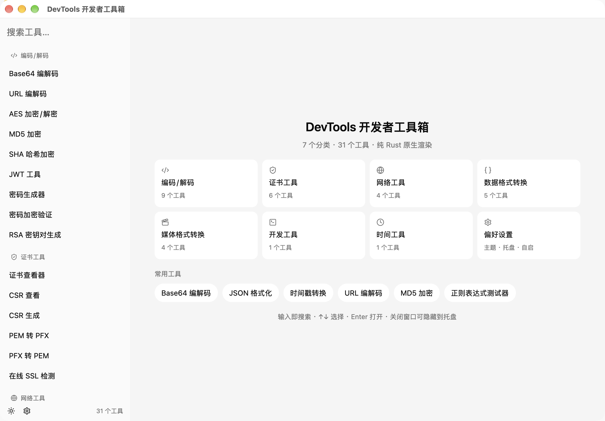
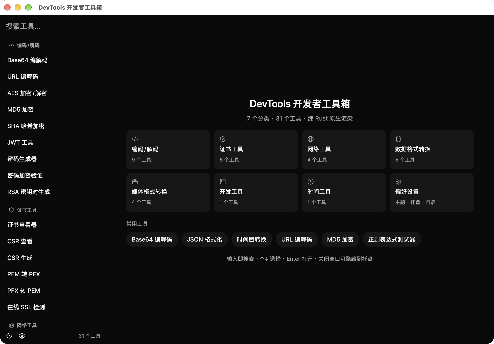
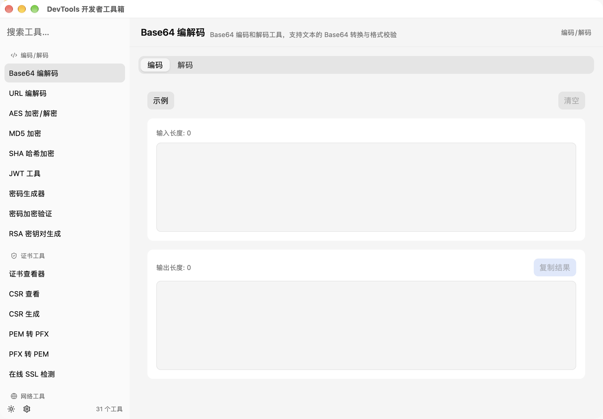
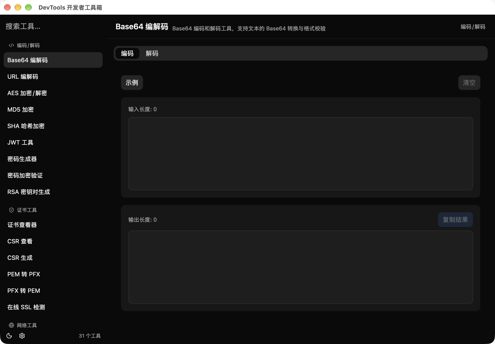

# DevTools 开发者工具箱

基于 **纯 Rust + GPUI**（原生 GPU 渲染）的 macOS 开发者工具箱——31 个开发工具集于一个轻量原生应用。无 WebView、无 Electron：单一二进制、秒级启动，浅色/深色双主题的 macOS 原生分组视图界面。

> 🌐 English: [README.md](README.md) · 详细工具使用指南：[docs/tools.md](docs/tools.md)

| 浅色 | 深色 |
| --- | --- |
|  |  |
|  |  |

## ✨ 特性

- **31 个工具 / 7 个分类**——编码、加密、证书、网络、数据格式、媒体等（见下表）
- **纯 Rust 原生渲染**——gpui（`gpui-pre` + `gpui-component`），无 WebView 内存开销
- **macOS 原生观感**——分组卡片、分段控件、系统开关、macOS 系统蓝主色；浅色 / 深色 / 跟随系统主题
- **单一主窗口**——分类侧栏即输即搜，工具内容区、托盘菜单、应用菜单
- **应用单例**——重复启动自动激活已有窗口，不会打开第二个应用
- **关闭即入托盘**——关闭窗口隐藏到托盘，随时唤回
- **可靠的加密实现**——与历史 JS 版本逐字节兼容，黄金向量校验（RFC 1321/6234/7914、noble AES 向量）

## 🧰 工具清单

| 分类 | 工具 |
| --- | --- |
| **编码 / 解码**（9） | Base64 编解码 · URL 编解码 · AES 加密 / 解密（5 模式 × 6 填充）· MD5 加密 · SHA / SHA-3 哈希 · JWT 工具（生成 / 解码）· 密码生成器 · 密码加密验证（bcrypt/PBKDF2/SHA/MD5）· RSA 密钥对生成（统一 PKCS#8/PKCS#1/OpenSSH 格式） |
| **证书工具**（6） | 证书查看器 · CSR 查看 · CSR 生成 · PEM 转 PFX · PFX 转 PEM · 在线 SSL 检测 |
| **网络工具**（4） | 子网掩码计算器 · IP 地址信息查询 · DNS 解析工具 · 域名 Whois 查询 |
| **数据格式转换**（5） | JSON 格式化 · 格式转换器（JSON/YAML/TOML）· JSON 转 Go 结构体 · SQL 转 Go 结构体 · SQL 转 Go Ent ORM |
| **媒体格式转换**（4） | 图片格式转换 · 图片预览器 · 图片压缩工具 · 视频格式转换（调用系统 FFmpeg） |
| **开发工具**（1） | 正则表达式测试器 |
| **时间工具**（1） | 时间戳转换 |

每个工具的详细用法见 [docs/tools.md](docs/tools.md)。

## 🚀 快速开始

**环境要求**：macOS 12+、Rust（2021 edition）、Apple Metal Toolchain（`xcodebuild -downloadComponent MetalToolchain`，gpui 的 Metal 着色器依赖）。视频转换工具使用时需系统安装 FFmpeg。

```bash
# 开发运行（watch 模式：运行中保存文件自动重启；退出应用即结束 watch）
make run

# 全量检查（cargo check + clippy 零警告 + 单元测试）
make check

# 打包应用 / DMG 安装镜像（release）
make app            # → target/DevTools.app
make dmg            # → target/DevTools.dmg（拖拽安装布局）
```

## 🛠 开发

```bash
make run-direct     # 不启用 watch 直接运行
make clippy         # clippy（零警告标准）
make test           # 单元测试 + 加密黄金向量
make fmt            # rustfmt
```

目录结构：单包 workspace——`crates/devtools` 双 target：**lib**（业务层：`registry`、`crypto`、`tools/`、`text_tools/`、`config`，无 UI 依赖）与 **bin**（GPUI 壳：`pages/` 工具页、`components/` 共享组件、`theme.rs`、`tray.rs` 等）。仓库规范与新增工具流程见 [AGENTS.md](AGENTS.md)。

## 📄 许可证

[MIT License](LICENSE)
